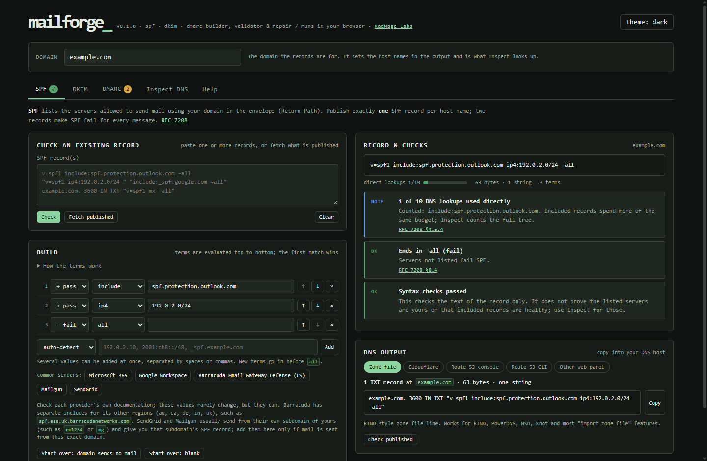

# MailForge v0.1.0

My SPF, DKIM and DMARC builder, validator and repair tool, with a live DNS inspector. It is one HTML page and two scripts that run in your browser: no install, no account, no server and no dependencies.

Use it online at **[radmagelabs.com/mailforge](https://radmagelabs.com/mailforge/)** (also at [radmageirl.github.io/mailforge](https://radmageirl.github.io/mailforge/)), or download the [latest release](https://github.com/RadMageIRL/mailforge/releases/latest) and open `index.html` from your own computer.



## What it does

- **SPF:** build the record as an ordered list of terms you can edit, move and remove. Paste several values at once and each is added as ip4, ip6 or include. Presets for Microsoft 365, Google Workspace, Barracuda Email Gateway Defense (US), Mailgun and SendGrid. It counts the DNS lookups against the limit of 10, flags `+all`, `?all`, terms after `all`, deprecated `ptr`, ranges with host bits set, terms that can never match, records over 450 bytes, and strings joined without a space. Paste two SPF records and it proposes one merged record for you to review.
- **DKIM:** paste a DNS record, a zone-file or opendkim line (the selector is taken from it), a PEM public key or a bare base64 key. It reports the key type and length against [RFC 8301](https://www.rfc-editor.org/rfc/rfc8301) (no SHA-1, RSA of at least 1024 bits, 2048 recommended), converts PKCS#1 RSA keys and SPKI-wrapped Ed25519 keys to the form DKIM publishes, and refuses private keys.
- **DMARC:** a form for every tag, a plain-English explanation of what the policy does, and warnings for real risks such as subdomains with a weaker policy or no report address. Checks follow [RFC 7489](https://www.rfc-editor.org/rfc/rfc7489) and say where [RFC 9989](https://www.rfc-editor.org/rfc/rfc9989), which replaced it in May 2026, differs (`t=`, `psd=` and `np=` added; `pct=`, `rf=` and `ri=` removed).
- **Inspect DNS:** looks up what is published right now. It follows every SPF include and redirect to count lookups and void lookups across the whole tree, checks that outside DMARC report addresses have authorized your reports, checks DKIM selectors (including Microsoft 365 style CNAMEs), lists the MX hosts, and compares each result with what you built.
- **DNS output:** always one TXT record, split into strings of at most 255 bytes when needed, as a zone-file line, for Cloudflare, the Route 53 console, the Route 53 CLI (JSON), or any web panel. Each view says how many strings the record has and warns about the panel's traps, and **Check published** compares what is in DNS with what you built.
- **Repairs are proposals.** Nothing changes until you apply one, and each change is labeled: `format` (same meaning), `no effect` (removes terms receivers never evaluate), `merge` (address ranges covering exactly the same addresses), `fix` (changes how receivers behave) or `by hand` (needs your decision). A record with errors is never loaded into the builder as-is, so a broken record is never fixed silently.
- Light, dark and system themes, keyboard navigation between tabs, links straight to a tab (`#spf`, `#dkim`, `#dmarc`, `#inspect`, `#help`), and a layout that works at phone width.

"Valid" here means the record passes syntax, limit and pitfall checks against the RFCs. MailForge cannot know whether the servers in your SPF record are really yours or whether your mail server signs with the private key that matches the published DKIM key. The last step of the checklist on the Inspect tab is sending a test message and reading its Authentication-Results header.

## DNS lookups and privacy

Building and checking records happen entirely in the page. Only **Inspect**, **Fetch published** and **Check published** use the network, and they send only the DNS names being looked up (such as `_dmarc.example.com`) to a public DNS-over-HTTPS resolver:

- [Cloudflare](https://developers.cloudflare.com/1.1.1.1/encryption/dns-over-https/) at `cloudflare-dns.com`, with Google as the fallback (the default), or
- [Google Public DNS](https://developers.google.com/speed/public-dns/docs/doh) at `dns.google`, or either one alone (pick it on the Inspect tab).

The records you type are never sent anywhere, the page sends no referrer with those lookups, and its Content Security Policy allows connections to those two resolvers only. There are no accounts, ads, analytics or tracking. Your work is saved in this browser's local storage so it survives a reload; a pasted private key is never saved.

Everything except the lookups works offline, including from a copy opened straight from disk.

## Running it

Node 22 or newer runs the tools; the page itself needs nothing.

```
node tools/serve.mjs            # the repository at http://127.0.0.1:8080/
node tools/build.mjs            # the production build in dist/, with the SHA-256 of each file
node tools/build.mjs --verify   # also proves the build is reproducible
node tools/serve.mjs dist 8081  # preview the build
node --test                     # unit tests and release checks
node tools/smoke.mjs            # browser tests on dist/ (needs Chrome; CHROME_PATH picks another Chromium browser)
node tools/check-links.mjs      # checks every outside link in the page and this README (uses the network)
```

The browser tests answer DNS lookups from fixtures, so they never reach a real resolver. CI runs the unit tests and the reproducible build on Ubuntu and Windows with Node 22 and 24, then the browser tests on Ubuntu.

| File | What |
|---|---|
| [index.html](index.html) | The page: markup, styles and help text. |
| [app.js](app.js) | The page code: state, rendering and events. |
| [mailforge-core.js](mailforge-core.js) | All parsing, validation, repair, DNS output and DNS-over-HTTPS logic. No DOM, so the page and the tests share it. |
| [test/](test) | Unit tests and release checks (`node --test`). |
| [tools/](tools) | Build, local server, browser tests and link check. |

## Browser support

Current versions of Chrome, Edge, Firefox and Safari. The page uses `color-mix()` and `:has()`, so the oldest that work are Chrome and Edge 111, Firefox 121 and Safari 16.2. I test it in Chrome and Edge (automated) and Firefox; Safari is not tested.

## Limitations

- The organizational domain (used for the DMARC fallback and outside report addresses) is estimated from a short list of two-label suffixes such as co.uk, not the full Public Suffix List or the RFC 9989 DNS tree walk.
- SPF macros (`%{i}` and so on) are syntax-checked but not expanded, so `exists` and macro targets are not followed. For `mx`, it counts the MX hosts but does not look up each host's addresses.
- DKIM: it cannot confirm that your signer uses the private key matching the published key. Send a test message.
- DKIM keys cannot be listed from DNS; Inspect checks the selectors you give it (and, if you ask, a list of common ones).
- The Cloudflare and Route 53 instructions follow their documented behavior as of 2026. Panels change, so use Check published after publishing.
- Provider presets follow each provider's documentation as of November 2026. SendGrid and Mailgun usually send from their own subdomain of yours, whose SPF record they give you.

## Security

If you find a security problem, please report it privately through [Report a vulnerability](https://github.com/RadMageIRL/mailforge/security/advisories/new) on GitHub rather than in a public issue. Everything else goes in [issues](https://github.com/RadMageIRL/mailforge/issues).

## License

GPL-3.0-or-later (see [LICENSE](LICENSE)).

MailForge is part of [RadMage Labs](https://radmagelabs.com/), my collection of free browser tools.
